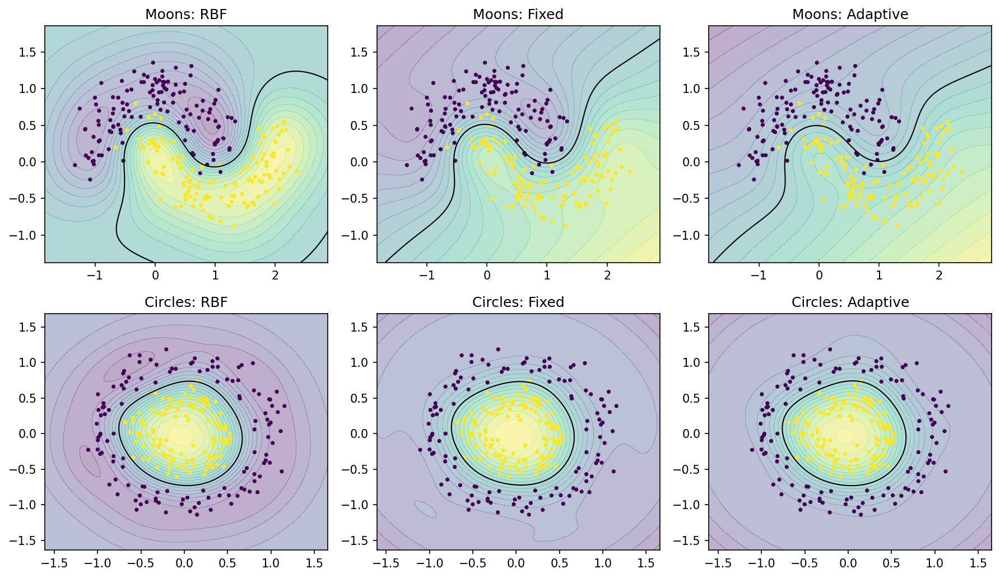
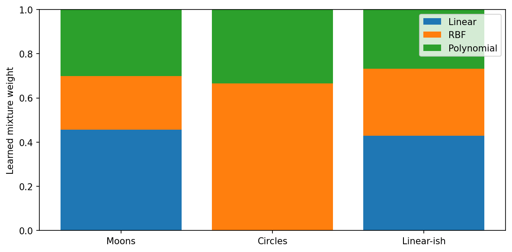
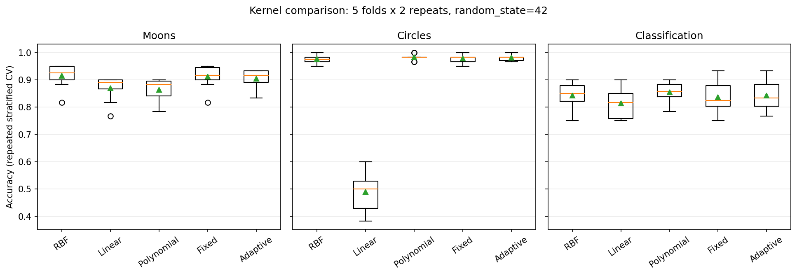

Kernel visualizations
=====================

These figures are generated from reproducible synthetic-data examples using
``svdynamics``. They illustrate model behavior, not a claim that any composite
kernel is universally superior to an individual kernel.

Decision boundaries
-------------------

The panels compare a standard RBF SVM, a fixed-weight composite kernel, and
an adaptive composite kernel on the same two-dimensional datasets. All models
use standardized input features. Shading represents the decision function;
the black contour marks the decision boundary.

Generated by ``generate_decision_boundaries.py`` using the package's
``SVDClassifier``, ``CompositeKernel``, and ``AdaptiveCompositeKernel``.

Learned adaptive kernel weights
-------------------------------

The next figure shows the non-negative mixture weights learned by
``AdaptiveCompositeKernel`` from three binary datasets. Each row of weights
sums to one. Kernel-target alignment is computed from the training labels;
the learned weights are not selected to maximize validation accuracy.

Generated by ``generate_kernel_weights.py``. The figure uses the direct
``AdaptiveCompositeKernel.fit(X, y)`` interface. When fitting through
``SVDClassifier``, inspect ``clf.kernel_.weights_`` instead.

Repeated cross-validation comparison
------------------------------------

Accuracy distributions below use five-fold repeated stratified cross-validation
with two repeats and a fixed random seed (42). Standardization and adaptive
weight fitting occur inside each training fold. Results are specific to these
synthetic datasets and hyperparameter choices.

Generated by ``generate_cv_figure.py``. A single RBF kernel may match or
outperform the adaptive mixture; compare kernels using out-of-sample metrics
appropriate for your task.

Interactive kernel explorer
---------------------------

Experiment with kernel geometry and parameter changes in the
`SVM Kernel Explorer <https://apps.datasciencedynamics.com/svm_kernel_explorer/>`_.
The explorer is a separate educational application and is not a benchmark
of the ``svdynamics`` Python package.

Reproducing the figures
-----------------------

Copy the three ``generate_*.py`` scripts to a directory named
``docs_visualization_assets`` at the repository root. The scripts write the
images into ``docs_visualization_assets/source/_static`` by default. Copy the
resulting PNG files into ``source/_static`` before building Sphinx, or adjust
the scripts' output paths to point directly to ``source/_static``.

.. code-block:: bash

   python docs_visualization_assets/generate_decision_boundaries.py
   python docs_visualization_assets/generate_kernel_weights.py
   python docs_visualization_assets/generate_cv_figure.py
   python -m sphinx -b html source docs
